# Backpack-mod

Versión **1.3.1** · Autor **Mania5diaz** · Minecraft **26.3** · Forge **66.0.6** · Java **25**.

## Capturas del mod

Los seis niveles de mochila colocados sobre bloques, de cuero a netherite.

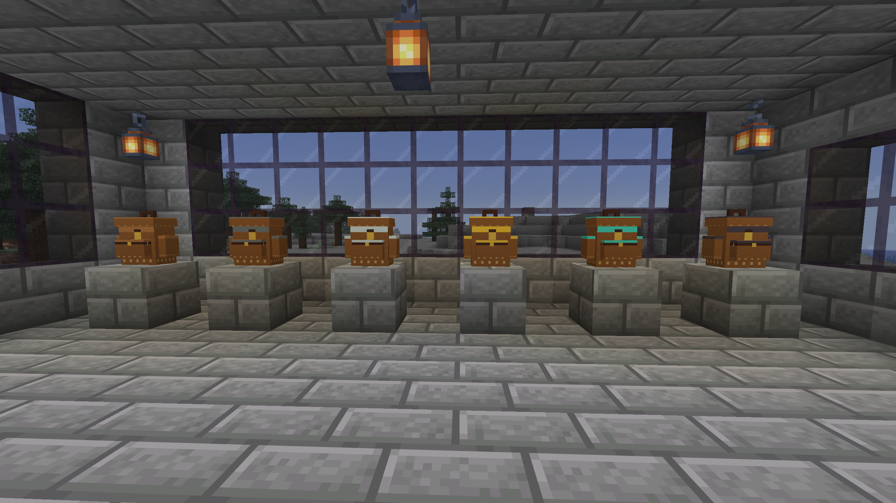

### Cuero, piedra y hierro

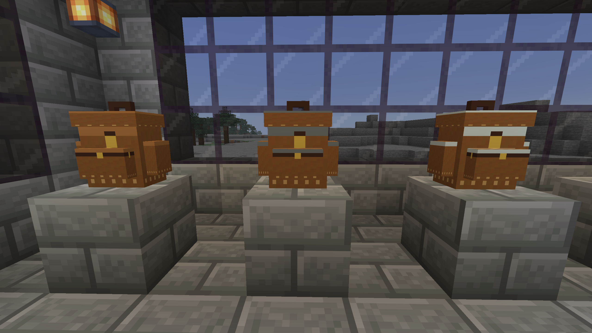

### Oro, diamante y netherite

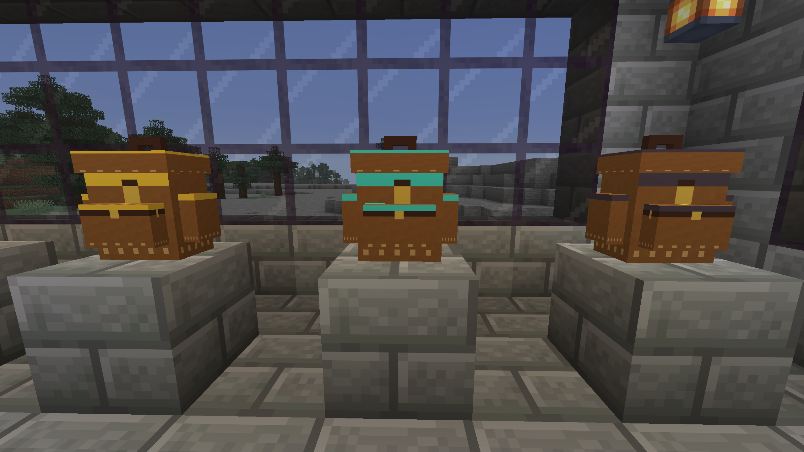

## Mochilas, espacio y plantillas

| Nivel | Material | Espacios principales | Cuadrícula | Plantillas admitidas |
|---|---|---:|---:|---|
| 0 | Cuero | 9 | 9×1 | Mesa de crafteo |
| 1 | Piedra | 18 | 9×2 | Anterior + horno |
| 2 | Hierro | 27 | 9×3 | Anteriores + alto horno y ahumador |
| 3 | Oro | 63 | 21×3 | Anteriores + comida |
| 4 | Diamante | 90 | 15×6 | Anteriores + flechas |
| 5 | Netherite | 117 | 13×9 | Anteriores + compartimento para 9 cajas de shulker |

Todas las casillas del almacenamiento están visibles a la vez. El rectángulo tiene 9 columnas hasta hierro, 21 en oro, 15 en diamante y 13 en netherite. Todas las filas están completas, sin casillas de relleno ni páginas. Los compartimentos de las plantillas son adicionales al almacenamiento principal.

## Recetas de las mochilas

Nivel 0: se conserva la receta de ocho cueros y un cofre normal.

```text
Cuero  Cuero  Cuero
Cuero  Cofre  Cuero
Cuero  Cuero  Cuero
```

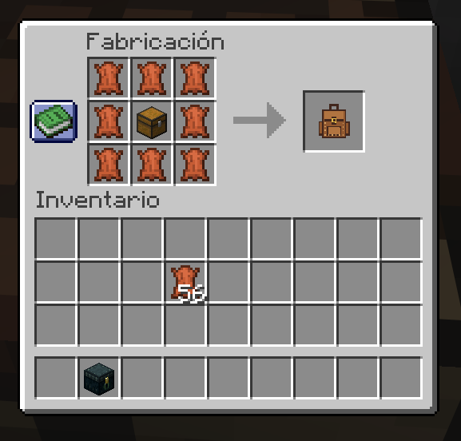

Niveles 1–5: mochila anterior al centro y **cuatro materiales en cruz**. Las esquinas quedan vacías.

```text
vacío       Material           vacío
Material    Mochila anterior   Material
vacío       Material           vacío
```

Son los espacios 2, 4, 6 y 8 de la mesa, con la mochila en el 5. Materiales: piedra normal, lingotes de hierro, lingotes de oro, diamantes y lingotes de netherite. Cada mejora usa cuatro unidades y conserva objetos, nombre, plantillas y sus compartimentos.

### Recetas de mejora por nivel

Cada captura muestra la mochila del nivel anterior en el centro y los cuatro materiales en cruz.

### Nivel 1: Piedra

Mochila de nivel 0 + cuatro bloques de piedra.

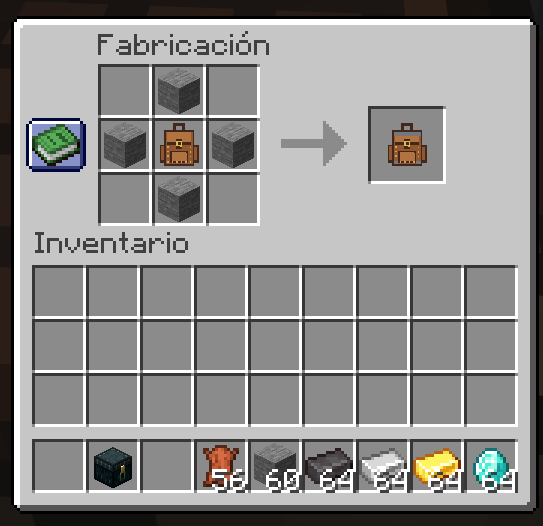

### Nivel 2: Hierro

Mochila de nivel 1 + cuatro lingotes de hierro.

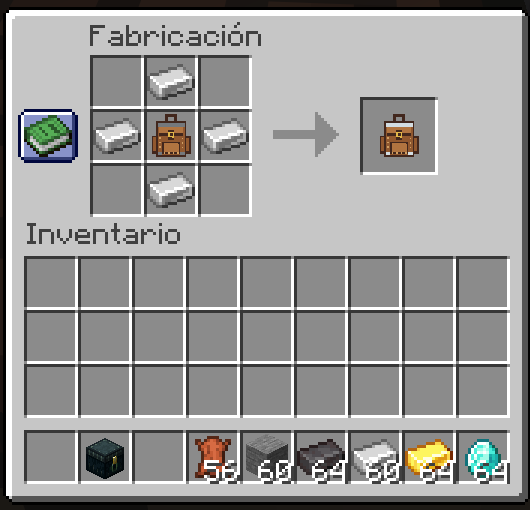

### Nivel 3: Oro

Mochila de nivel 2 + cuatro lingotes de oro.

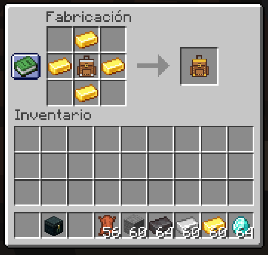

### Nivel 4: Diamante

Mochila de nivel 3 + cuatro diamantes.

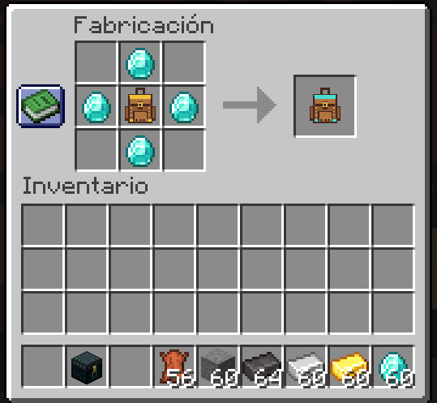

### Nivel 5: Netherite

Mochila de nivel 4 + cuatro lingotes de netherite.

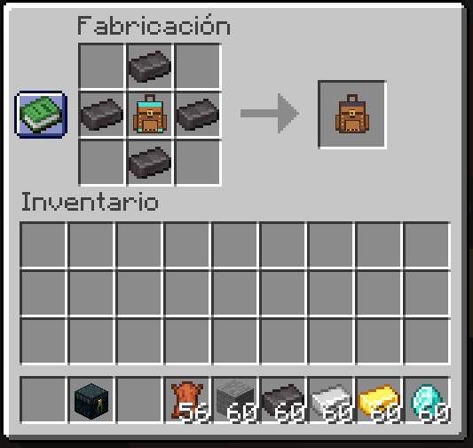

## Fabricar e instalar plantillas

Todas usan **ocho tablas de madera de cualquier tipo**, incluso mezcladas, alrededor del ingrediente central:

| Plantilla | Centro de la receta | Nivel mínimo |
|---|---|---:|
| Mesa de crafteo | Mesa de crafteo | 0 |
| Horno | Horno | 1 |
| Alto horno | Alto horno | 2 |
| Ahumador | Ahumador | 2 |
| Comida | Una azada de cualquier material; la de madera sirve | 3 |
| Flechas | Una flecha normal | 4 |
| Cajas de shulker | Un cofre de Ender | 5 |

### Capturas de las recetas de plantillas

En todas las recetas, rodea el ingrediente central con ocho tablas de madera.

#### Mesa de crafteo

Centro: una mesa de crafteo. Nivel mínimo de mochila: **0**.

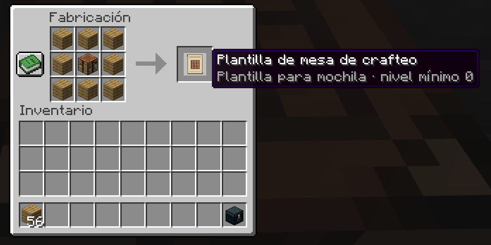

#### Horno

Centro: un horno. Nivel mínimo de mochila: **1**.

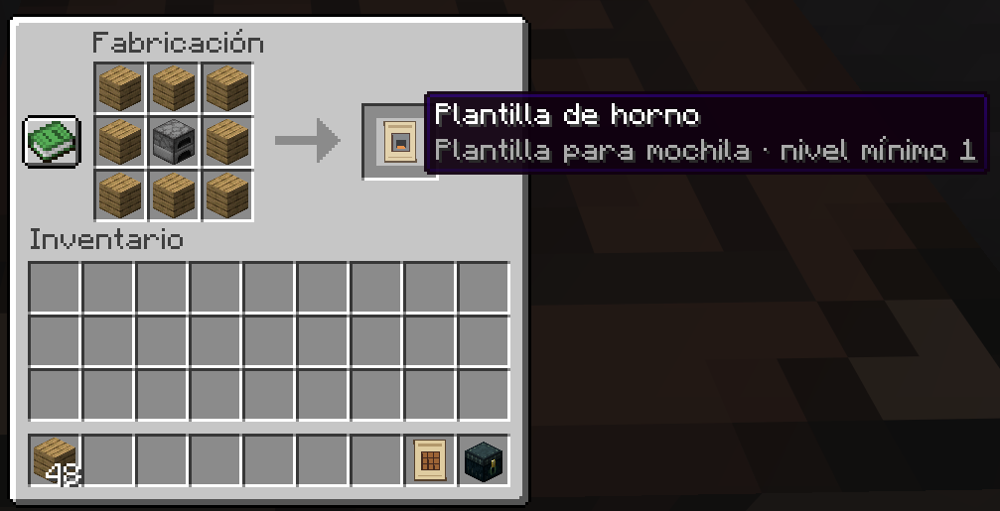

#### Alto horno

Centro: un alto horno. Nivel mínimo de mochila: **2**.

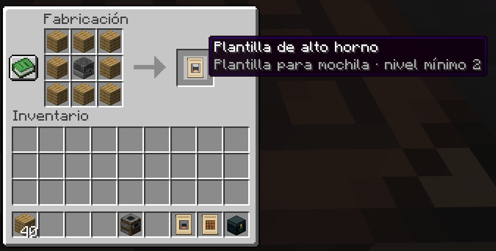

#### Ahumador

Centro: un ahumador. Nivel mínimo de mochila: **2**.

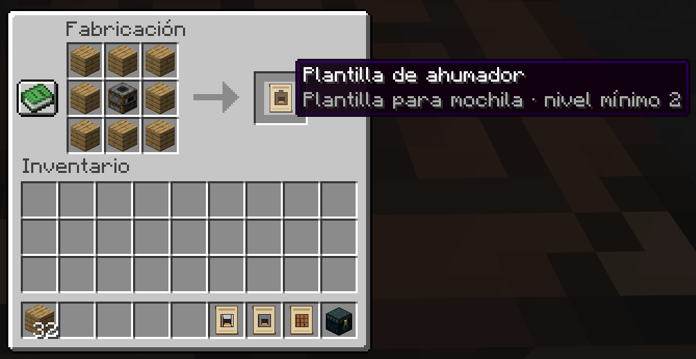

#### Comida

Centro: una azada de cualquier material; la captura muestra una de madera. Nivel mínimo de mochila: **3**.

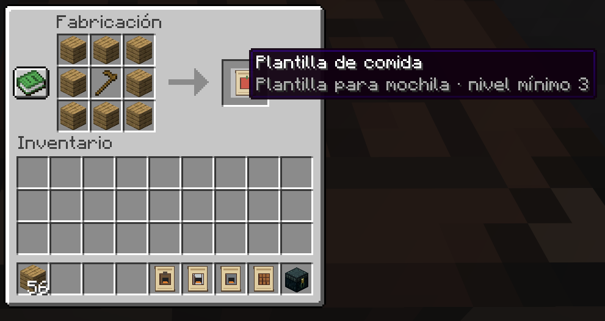

#### Flechas

Centro: una flecha normal. Nivel mínimo de mochila: **4**.

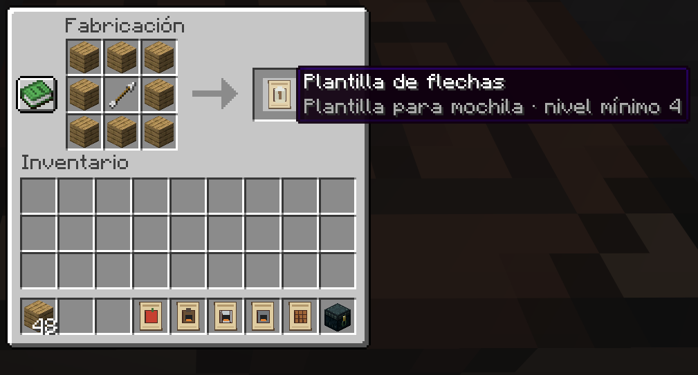

#### Cajas de shulker

Centro: un cofre de Ender. Nivel mínimo de mochila: **5**.

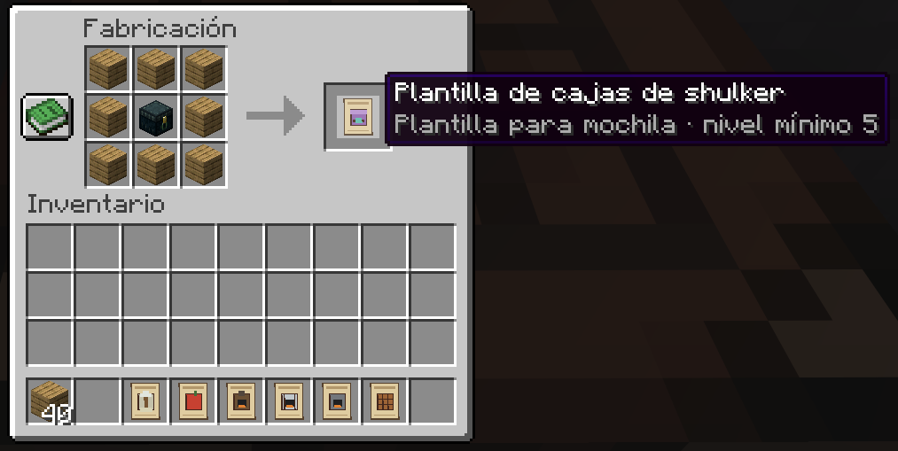

Abre la mochila y coloca la plantilla en su espacio correspondiente del panel lateral correspondiente. El botón contiguo se habilita al instalarla. Los espacios bloqueados indican el nivel mínimo al pasar el cursor. Se instala una plantilla de cada tipo; puedes retirarla después.

Las plantillas aparecen en la pestaña creativa **Backpack-mod**, junto a las seis mochilas. También se encuentran buscando "plantilla". Su descripción indica el nivel mínimo.

### Funciones

- **Mesa de crafteo:** cuadrícula 3×3 y resultado, con consumo normal de ingredientes. Sus ingredientes permanecen guardados al cerrar.
- **Horno, alto horno y ahumador:** cada uno tiene entrada, combustible y salida independientes. Usan las recetas y combustibles de Minecraft, conservan el progreso y entregan experiencia al retirar el resultado. Trabajan con la mochila equipada, colocada en un lugar cargado del mundo o abierta desde la mano.
- **Comida:** cuatro espacios para una pila de comida por espacio. Al llevar la mochila equipada y tener hambre, consume un alimento y aplica sus efectos normales. No consume comida si el hambre está llena.
- **Flechas:** un espacio para una pila de flechas normales, espectrales o con efecto. Equipada la mochila, el arco o ballesta puede usar esa munición cuando no encuentra flechas en el inventario normal. Se consume munición según las reglas vanilla.
- **Cajas de shulker:** nueve espacios exclusivos, una caja por espacio, con su contenido. Requiere mochila de netherite y la plantilla instalada. Las nuevas cajas van en este compartimento, no en el almacenamiento principal.

Quitar una plantilla desactiva su función, pero **no borra sus objetos**. Reinstálala para recuperarlos. Las mochilas no aceptan otras mochilas en su interior.

La interfaz es transparente, sin panel de fondo, desenfoque ni oscurecimiento del mundo. A la izquierda están crafteo y los tres hornos; a la derecha comida, flechas y shulker. Cada botón está junto al espacio de su plantilla. La pantalla ajusta su escala para caber en la ventana sin cambiar la preferencia global de escala GUI. Los hornos señalan entrada, combustible y salida. Admiten los combustibles de Minecraft, incluidos carbón, carbón vegetal, tablas y cubos de lava, y no cocinan sin combustible.

## Equipar, abrir y colocar

- Consigue la básica con `/give @s backpack_mod:backpack`, por receta o como botín de un mob portador.
- Equípala en el slot junto a la armadura, o agáchate y haz clic derecho en el aire con ella si el slot está vacío.
- **B** abre/cierra la mochila equipada. La tecla se cambia en **Controles → Backpack-mod**. Escape también cierra.
- Para abrir una mochila de la mano, haz clic derecho en el aire.
- Para **colocarla**, haz clic derecho con ella sobre la cara superior de un bloque completo con soporte sólido. No se coloca sobre aire, líquidos ni apoyos parciales. Si el bloque abre una interfaz, agáchate al colocarla.
- Clic derecho sobre la mochila colocada abre su inventario. **Agacharse + clic derecho** la recoge conservando todo. No se puede recoger mientras alguien la está utilizando.
- Al romper la mochila o quitar su apoyo, devuelve una mochila con sus datos, siguiendo las reglas de drops del mundo.
- Se puede llevar mochila y pechera simultáneamente; el modelo de mochila aparece en la espalda.
- Al morir, la mochila equipada cae con los objetos; con `keepInventory`, se conserva al reaparecer.

Guarda el objeto del cursor antes de cambiar del inventario del jugador a la mochila con la tecla.

## Botín de mobs

Esqueletos, zombis y creepers normales tienen un 20 % inicial de probabilidad de llevar mochila. La selección se mantiene al recargar el mundo. La sueltan al morir, también después de explotar el creeper, respetando las reglas de botín.

Cada mochila de botín contiene un libro con encantamiento y nivel aleatorios, comida y minerales, con posibles diamantes. El botín usa por ahora la mochila básica. Probabilidad y cantidades están en `Config.java`.

## Guardado y actualización

El id original `backpack_mod:backpack` se conserva para las mochilas de cuero. Las mochilas existentes mantienen su almacenamiento al aumentar las capacidades. Las plantillas, sus objetos y el progreso de los hornos viajan dentro del ítem, también al colocarlo o mejorar su nivel.

Las cajas de shulker que ya estuvieran en el inventario principal de una mochila antigua se conservan y se pueden retirar; las nuevas inserciones requieren el compartimento de shulker.

Cierra Minecraft completamente antes de cambiar de jar. Deja un solo jar de Backpack-mod instalado. En multijugador, servidor y clientes deben usar la nueva versión. No se copia automáticamente ningún jar a CurseForge ni se modifica la instancia personal.

## Compilar y probar

```powershell
$env:JAVA_HOME = 'C:\Program Files\Eclipse Adoptium\jdk-25.0.5.8-hotspot'
$env:Path = "$env:JAVA_HOME\bin;$env:Path"
$env:GRADLE_USER_HOME = "$PWD\.gradle-user-home"
.\gradlew.bat build "-Dorg.gradle.java.home=$env:JAVA_HOME"
.\gradlew.bat runGameTestServer "-Dorg.gradle.java.home=$env:JAVA_HOME"
.\gradlew.bat runClient "-Dorg.gradle.java.home=$env:JAVA_HOME"
```

El jar está en `build/libs/Backpack-mod-1.3.1.jar`. El cliente usa `run/`; las pruebas usan `build/gametest-run`. Cierra el cliente de desarrollo antes de recompilar: Forge carga sus clases directamente desde el proyecto. Los recursos se copian con `stageModResources` después de compilar, evitando que el procesado de recursos borre clases del directorio combinado que utiliza Forge.

El arte original se genera con `python scripts/generate_templates_resources.py`, que también actualiza las recetas en cruz y las de las plantillas. Las capacidades viven en `BackpackLevel.java`; permisos y tipos de plantilla en `Template.java`.

## Verificación

- Compilación con `BUILD SUCCESSFUL`.
- **21 pruebas propias** aprobadas; **22** contando la incluida por Minecraft.
- Se verifican recetas cargadas, cadena de mejoras, niveles, cuadrículas y último espacio, guardado del jugador, muerte y equipamiento, plantillas y sus permisos, serialización, crafteo con consumo de ingredientes, los tres tipos de horno y combustible, alimentación, disparo real de arco con munición de la mochila, colocación/recogida y caída del contenido al quitar el apoyo, y correspondencia entre menús del cliente y servidor.
- Revisión visual en una partida local: netherite 13×9, fondo transparente, cuatro slots de comida, un slot de flechas, nueve slots de shulker sin espacios extra y entrada/combustible/salida del horno. Los botones se comprobaron con escalado automático.
- Regresión reproducida antes de corregir: `module_clicks` fallaba porque el horno tenía cero slots activos. Ahora pasa. La causa era la colisión entre el campo `Slot.index` y una variable capturada con el mismo nombre.
- `fuel_menu_cycles` coloca ingredientes y combustible mediante clics y recoge el resultado en los tres hornos; verifica carbón, carbón vegetal, tablas y lava, ausencia de cocción sin combustible y devolución del cubo.

**Pendiente de la prueba del usuario:** comodidad de tamaño/teclas, aspecto del bloque colocado, ballestas y convivencia con otros mods o resource packs. Las pruebas automáticas no sustituyen esa revisión. El teñido personalizable sigue pendiente.

